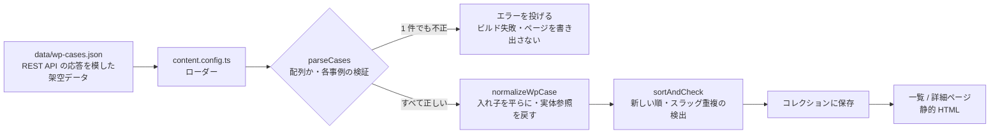

# tensaku-cms-data-example

ヘッドレス WordPress から受け取った導入事例のデータを検証し、Astro の静的ページで扱いやすい形に変換する公開用サンプルです。

自主制作サイトで実装した機能から、公開用に切り出し・調整したサンプルです。サイト全体のソースコードや共通の開発基盤は含みません。検証と変換の処理は元の実装からの抽出、データの読み込みと画面は公開用に作り直した最小構成です（詳しくは「[元の実装との関係](#元の実装との関係)」）。

- 元の公開サイト（架空のデザインレビューツール「TENSAKU」のサービスサイト）: https://tensaku.preview-dev.website/

> **このリポジトリのファイル構成・ディレクトリの分け方・スタイルは、公開用に用意したものです。元サイトの実際の構成とは異なります。**
>
> 同梱の導入事例はすべて架空のデータです。企業名・数値・画像の URL は実在しません。WordPress への接続や外部との通信は行いません。

## 担当範囲

元サイトのデザインは他社によるもので、私はデザイン制作を担当していません。担当したのはコーディングと実装で、このサンプルに含まれる範囲は次のとおりです。

- WordPress の REST API の応答（導入事例）の検証と、画面で使う型への変換
- 不正なデータでビルドを止める扱い
- 一覧・詳細ページへの受け渡し
- 上記のテスト

このサンプルの画面とスタイルは確認用に用意した簡素なもので、元サイトのデザインではありません。

## このサンプルで見てほしいこと

導入事例は、クライアントが WordPress の管理画面から追加・更新します。入力の不備がそのまま公開ページに出ないよう、ビルドの最初に次の処理をしています。

- **CMS の形と画面の形を分ける。** WordPress の応答は `title.rendered` や独自フィールド `tensaku.*` の入れ子になっています。これを検証したうえで平らな `CaseRecord` にそろえ、ページ側は WordPress の形を知らなくて済むようにしています。
- **1 件でも不正ならビルドを止める。** 一部の事例だけを除いて公開を続けると、欠けたことに気付きにくいためです。エラー文には事例のスラッグと項目名を入れ、どこを直せばよいかが分かるようにしています。
- **必須と任意を型で区別する。** 空白だけの文字列は空として扱います。業種（`industry`）は `null`、数値（`metrics`）は 0 件、企業の規模（`companySize`）は空文字を許可しています。ただし、キー自体が無い場合は不正として扱います（WordPress 側が常にすべてのキーを返す取り決めのため）。
- **URL にできないスラッグを弾く。** スラッグは詳細ページの URL になるため、半角英小文字・数字・ハイフンだけを許可します。日本語のスラッグ（WordPress ではエンコードされた `%e4%ba%8b…` の形で届く）や大文字は止めます。重複したスラッグも、ページの URL がぶつかるので止めます。
- **文字の扱い。** WordPress はタイトルなどの `&` を `&#038;` のような実体参照で返します。Astro は出力時に自動でエスケープするため、そのままだと画面に二重に出ます。そこで変換の段階で文字に戻し、タグは除去します。画面では `set:html` を使わず、すべて `{}` で出力します。

## 起動・テスト・ビルド

```bash
npm ci                 # 依存のインストール（package-lock.json どおり）
npm run dev            # 開発サーバー（http://localhost:4321/）
npm test               # テスト（Vitest）
npm run build          # 型チェック（astro check）＋静的ビルド（dist/ に出力）
npm run preview        # ビルド結果の確認
npm run build:invalid  # 不正なデータでビルドが止まることの確認（終了コード 1 で失敗します）
```

読み込むファイルは、環境変数 `CASES_FILE` で差し替えられます（既定は `data/wp-cases.json`）。`build:invalid` は、企業名が空の事例を含む `tests/fixtures/invalid-cases.json` を読みます。

## 使用技術・実行環境

| 用途 | 使用しているもの |
| --- | --- |
| 言語 | TypeScript 5.9 |
| 静的サイト生成 | Astro 7（Content Layer のローダー） |
| 検証 | Zod 4（Astro に同梱の `astro/zod`） |
| スタイル | Sass（SCSS）、FLOCSS の命名・層構成 |
| テスト | Vitest 4 |
| 実行環境 | Node.js 22.23.4 以上（22 系）・24.22.1 以上（24 系）・26.12.1 以上、npm |

CMS・データベース・外部 API・UI フレームワークは使っていません。

## 構成

```
.
├── data/
│   └── wp-cases.json         # WordPress の REST API の応答を模した架空データ（4 件）
├── src/
│   ├── cms/
│   │   ├── cases.ts          # 導入事例のスキーマ・検証・変換・並べ替え
│   │   ├── text.ts           # 実体参照の復元、必須文字列・スラッグの定義、エラー文の整形
│   │   └── display.ts        # 段落分け・日付・パスなど表示用の整形
│   ├── content.config.ts     # ビルド時にデータを読み、検証してコレクションに保存する
│   ├── layouts/Base.astro    # 確認用の最小レイアウト
│   ├── pages/
│   │   ├── index.astro       # 一覧
│   │   └── cases/[slug].astro # 詳細（事例 1 件につき 1 ページ）
│   └── styles/               # SCSS（FLOCSS）。確認用の簡素なスタイル
│       ├── main.scss         # 層の順に読み込むエントリー
│       ├── global/           # 変数・rem()・mq()（CSS を出力しない）
│       ├── foundation/       # 要素の土台（_base）
│       ├── layout/           # l-header / l-container
│       ├── component/        # c-tag
│       └── project/          # p-case-list / p-case
└── tests/
    ├── cases.test.ts         # 検証・変換（正常系・異常系）
    ├── display.test.ts       # 表示用の整形
    ├── build.test.ts         # 不正なデータで astro build が失敗すること
    └── fixtures/invalid-cases.json
```

読み始めるなら `src/cms/cases.ts` → `src/content.config.ts` → `src/pages/cases/[slug].astro` の順がおすすめです。

この構成は、検証・変換と画面への受け渡しを追いやすいように、このサンプル用に組んだものです。元サイトのディレクトリ構成・ファイル名・ファイルの分け方とは異なります。

### クラス名の付け方

スタイルは FLOCSS の層（Foundation / Layout / Component / Project）に分け、クラス名の接頭辞で層が分かるようにしています（`l-` `c-` `p-`）。導入事例の一覧・詳細のように、このページだけで使う見た目は `p-`、業種のラベルのように場所を選ばない部品は `c-` にしています。CMS の文字列を出すマークアップはクラス名に依存しないので、見た目を変えても検証・変換の処理とテストは変更せずに済みます。

文字サイズと余白は `global/_functions.scss` の `rem()` で px の値を rem に変換して書いています（`rem(14)` = `0.875rem`）。ブラウザの文字サイズ設定を変えたときに、文字と余白が一緒に拡大されるようにするためです。レイアウトはスマートフォン幅を基準にし、`mq()` で 768px 以上の指定を足しています（一覧は 2 列、数値の欄は 3 列）。

変数・関数・mixin は、このサンプル用に書いた最小限のものです。元サイトや普段の制作で使っている共通の SCSS（変数・関数・mixin など）は含みません。

## データの流れ



## ビルドが失敗したときの扱い

不正なデータを読むと、Astro のコンテンツ同期の段階でエラーになり、`astro build` は終了コード 1 で終わります。ページは 1 枚も書き出しません（`tests/build.test.ts` で、空の出力先にページが作られないことを確認しています）。

ローカルで以前に成功したビルドの `dist/` がある場合、その中身は消えずに残ります。これは Astro が書き出しの前に止まるためで、このサンプルにロールバックの仕組みがあるわけではありません。公開環境で前回の公開内容が配信され続けるかどうかは、配信サービス側の仕組みによります。

## 元の実装との関係

| ファイル | 扱い | 内容 |
| --- | --- | --- |
| `src/cms/cases.ts` | 抽出・変更 | スキーマ（`wpCaseSchema`）、`normalizeWpCase`、`sortAndCheck` は元の実装から抽出しました。画像は、元の実装では別の処理で取り込んで寸法を得るため URL と代替テキストだけを渡していましたが、このサンプルは画像を取り込まないので、幅と高さもそのまま渡すように変えました。`parseCases` は、元の取得処理が行っていた「応答が配列か」の確認と、検証・並べ替えをまとめた公開用の関数です |
| `src/cms/text.ts` | 抽出 | 元の共通処理のうち、検証に使う部品（`requiredText`・`slugText`・`parseOrThrow`・`formatIssues`・`describeItem`）と `decodeWpText` だけを抽出しました |
| `src/cms/display.ts` | 抽出 | 元の表示用ヘルパーのうち、文字列を整形する 4 つの関数です |
| `src/content.config.ts` | 再実装 | 元の実装は WordPress から取得します。このサンプルではローカルの JSON を読むだけのローダーに作り直しました |
| `src/pages/` `src/layouts/` | 新規 | 確認用に書き下ろした簡素な一覧・詳細ページです。元サイトのマークアップ・デザイン・写真は含みません |
| `src/styles/` | 新規 | 元サイトと同じく Sass（SCSS）と FLOCSS の層で書いていますが、ファイルの分け方・変数・関数・mixin はこのサンプル用に書き下ろしたものです。元サイトのスタイルと共通の SCSS は含みません |
| `tests/cases.test.ts` | 抽出・変更 | 元のテストのうち、文字の復元・検証・並べ替えの部分を抽出しました。キーの欠落、型の不一致、画像 URL の形式、数値の件数上限、任意項目、応答全体（`parseCases`）のテストを追加しました |
| `tests/display.test.ts` `tests/build.test.ts` | 新規 | 表示用の整形と、不正なデータでビルドが止まることのテストです |
| `data/` `tests/fixtures/` | 新規 | このサンプル用に作った架空のデータです |

ディレクトリ構成とファイルの分け方は、このサンプルに合わせたものです。元サイトや普段の制作環境の構成とは異なります。元サイトのソースコードをそのまま並べたものではありません。

## 確認済みの内容と未確認の事項

確認済み（2026 年 11 月 4 日）:

- `npm ci` → `npm test` → `npm run build` が、`node_modules` のない状態から成功すること（Linux、Node.js 24.22.2・npm 11.21.1）
- テスト 25 件（検証・変換 21 件、表示用の整形 3 件、ビルド 1 件）
- `npm run build:invalid` が終了コード 1 で失敗し、事例のスラッグと項目名を含むエラーを出すこと
- Chromium（Playwright、ビルド結果をプレビューで表示）で、PC 幅とスマートフォン幅（375px）の次の内容
  - 一覧が公開日の新しい順に並ぶこと、実体参照（`&amp;`・`&#8211;`・`&#8220;`）が文字で表示されること
  - 業種・規模・数値が無い事例で、その欄を出さないこと
  - 一覧から詳細へキーボード（Tab・Enter）で移動できること、横スクロールが出ないこと
  - PC 幅で一覧が 2 列、数値の欄が 3 列になり、375px では 1 列になること

未確認:

- 実際の WordPress との接続（このサンプルは通信を行いません）
- Safari・Firefox・実機のスマートフォンでの表示
- macOS・Windows での `npm ci`・テスト・ビルド（Linux でのみ確認しています）
- スクリーンリーダーでの読み上げ

## 公開していない部分

元サイトのうち、次の部分はこのサンプルに含めていません。

- WordPress からの取得処理（通信・認証・ページ送り・一時的な失敗への対応）と画像の取り込み
- WordPress 側のプラグイン、下書きの確認・公開の流れ
- よくある質問・バナーなど、導入事例以外のデータ
- サイト全体の構成、共通の開発基盤、ビルド・配信の設定

## 著作権・ライセンス

- このリポジトリのコードと架空データの著作権は作者にあります。ライセンスは未設定です（再利用の条件は未確定です）。
- 依存ライブラリ（Astro・Zod・Vitest など）は、それぞれのライセンスに従います。このリポジトリには同梱せず、`npm ci` で取得します。
- 画像・ロゴ・フォントは含みません。
